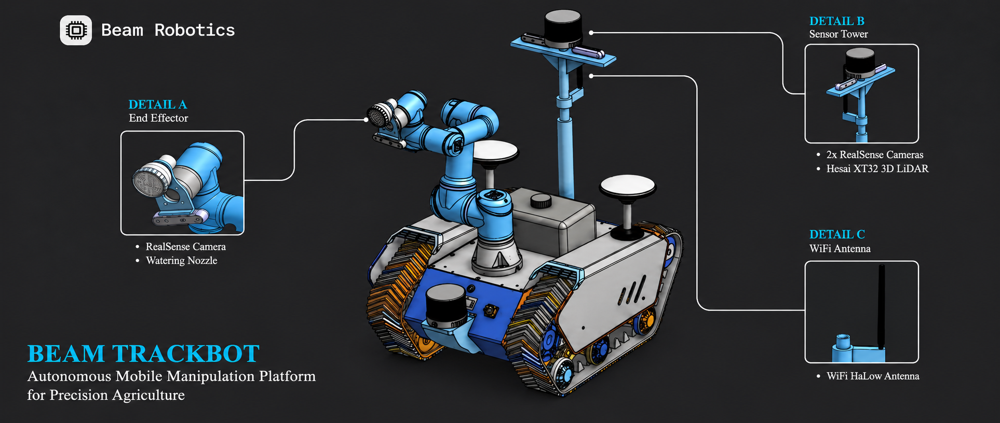

<div align="center">



# Beam TrackBot V3
### Autonomous Mobile Manipulation Platform for Precision Agriculture | ROS2 + MoveIt2 + Nav2

[](https://docs.ros.org/en/humble/)
[](https://moveit.ros.org/)
[](LICENSE)
[](https://github.com/xaatim)

</div>

---

## Overview

The **Beam TrackBot V3** is the next-generation tracked mobile manipulation platform for precision agricultural operations under **Beam Robotics**. Building on the simulation foundation of `beam_agrobot_v2`, V3 transitions the platform from a custom wheeled differential-drive rover with a 5-DOF arm to an industrial-grade **AgileX Bunker Mini 2.0** tracked chassis paired with a **Universal Robots UR3e** 6-DOF collaborative arm, mast-mounted 3D perception, and long-range wireless connectivity.

Mechanical CAD design for V3 is complete, animation work is underway, and initial ROS2 workspace setup has started (`src/robot_description`). Full simulation integration, autonomy pipelines, and hardware deployment are staged progressively across V3 and V4.

Beam TrackBot V3 is developed under **[Beam Robotics](https://github.com/xaatim/Beam-Command-Center)** — an applied robotics initiative and prospective startup founded by **[Hatim Ahmed Hassan](https://www.linkedin.com/in/hatim-ahmed-hassan-713214194/)**, focused on building autonomous systems for agriculture, infrastructure, and industrial automation.

---

## From V2 to V3

<div align="center">

| | AgroBot V2 | TrackBot V3 (In Development) |
|---|---|---|
| **Mobile Base / Drivetrain** | Custom differential drive (2 rear wheels + front caster) | **AgileX Bunker Mini 2.0** tracked UGV (zero-radius turns) |
| **Manipulator** | Custom 5-DOF arm (MoveIt2 + TRAC-IK) | **Universal Robots UR3e** (6-DOF collaborative arm) |
| **LiDAR / Mapping** | 2D LiDAR (SLAM Toolbox / AMCL) | Hesai XT32 3D LiDAR + 3D perception |
| **Vision** | Eye-in-hand RealSense D435 + HSV/YOLO | Eye-in-hand RealSense + sensor tower 2x RealSense cameras |
| **Connectivity** | Standard link / Command Center | WiFi HaLow antenna for extended field range |
| **Repository Status** | Simulation-complete (`beam_agrobot_v2`) | CAD complete, animation in progress, `robot_description` started |

</div>

> Previous version: [beam_agrobot_v2](https://github.com/xaatim/beam_agrobot_v2) | V1 prototype: [Smart-Agricultural-Robot](https://github.com/xaatim/Smart-Agricultural-Robot)

---

## System Architecture

The repository is structured as a ROS2 workspace, starting with the robot description package:

```text
beam_trackbot_v3/
├── src/
│   └── robot_description/   → URDF/Xacro, CAD meshes, materials, sensor mounts
├── robot_navigation/        → Planned: 3D SLAM / Nav2 / field localization config
├── robot_vision/            → Planned: multi-camera crop detection & dosing nodes
├── moveit_config/           → Planned: MoveIt2 SRDF, kinematics, OMPL planner
├── media/                   → CAD callouts, renders, animations, simulation media
└── models/                  → Planned: vision model weights

```

**Target operational pipeline:**

```text
Hesai XT32 3D LiDAR + Dual Tower RealSense → 3D Mapping & Obstacle Perception
                              ↓
        Autonomous Navigation & Row Alignment (Bunker Mini 2.0)
                              ↓
        Eye-in-Hand RealSense + Nozzle → 3D Crop Localization & Precision Dosing
                              ↓
        Universal Robots UR3e (MoveIt2) → Collision-Free Reach & Actuation

```

---

## Hardware & Mechanical Design

The TrackBot V3 integrates industrial-grade off-the-shelf mobile manipulation hardware with custom sensor mounts built for rough agricultural terrain and modular field maintenance:

* **AgileX Bunker Mini 2.0 Tracked Base** — Compact, heavy-duty tracked UGV chassis engineered for all-terrain traction, obstacle traversal, and zero-radius spin-in-place turns between crop rows
* **Universal Robots UR3e (6-DOF Arm)** — Front-mounted 6-DOF collaborative robotic arm providing full wrist orientation flexibility (e.g., angling the nozzle underneath dense foliage) and repeatable precision manipulation
* **Elevated Sensor Tower (Detail B)** — Mast-mounted assembly integrating a **Hesai XT32 3D LiDAR** and **2x RealSense cameras** for 360° 3D mapping and wide-angle crop-row visibility above foliage
* **WiFi HaLow Connectivity (Detail C)** — Dedicated **WiFi HaLow antenna** mount for low-power, long-range wireless telemetry and control across outdoor agricultural plots
* **Top-Deck Modules** — Dual dome/puck sensor or antenna housings mounted on the upper deck alongside the central sensor mast

| Detail A: End-Effector | Detail B: Sensor Tower | Detail C: WiFi Antenna |
| --- | --- | --- |
| RealSense Camera + Watering Nozzle | 2x RealSense Cameras + Hesai XT32 3D LiDAR | WiFi HaLow Antenna |

**End-Effector (Detail A):**
Custom wrist mount bolted to the UR3e tool flange, pairing an Intel RealSense camera with a precision watering nozzle for close-range target detection and targeted application.

---

## Current Progress & Simulation Status

* **Mechanical CAD:** Completed (AgileX Bunker Mini 2.0 chassis integration, UR3e mounting, Detail A end-effector, Detail B sensor tower, and Detail C WiFi HaLow antenna callouts).
* **Animation & Visuals:** In progress (render/animation assets and presentation visuals).
* **ROS2 Workspace (`src/robot_description`):** Initial commit pushed; URDF/Xacro and mesh integration in progress.

---

## Roadmap

### V3 — Design, Simulation & Autonomy Upgrades (Active)

* [x] Complete V3 mechanical CAD design (Bunker Mini 2.0 base, UR3e manipulator, sensor tower, WiFi HaLow mount)
* [ ] Complete V3 animation and visual media assets
* [ ] Finalize `robot_description` URDF/Xacro and meshes from V3 CAD
* [ ] Integrate Hesai XT32 3D LiDAR and dual tower RealSense + eye-in-hand camera sensors in simulation
* [ ] Configure MoveIt2 arm planning for UR3e and autonomous navigation/task execution for Bunker Mini 2.0
* [ ] Integrate GPS/GNSS, cliff/terrain safety, battery SOC monitoring, and fleet/task coordination

### V4 — Physical Hardware Build & Field Deployment

* [ ] Assemble physical AgileX Bunker Mini 2.0 + Universal Robots UR3e platform with custom sensor tower and WiFi HaLow hardware
* [ ] Map `ros2_control` and hardware driver interfaces to physical base and arm controllers
* [ ] Deploy real-world YOLO vision pipeline and field calibration
* [ ] Live integration with **Beam Command Center**

---

## Planned Software Stack

| Component | Planned Technology |
| --- | --- |
| Framework | ROS2 Humble |
| Mobile Base | AgileX Bunker Mini 2.0 |
| Manipulator | Universal Robots UR3e (6-DOF) |
| 3D LiDAR | Hesai XT32 |
| Vision / Depth | Intel RealSense (End-Effector + 2x Tower Cameras) |
| Wireless Link | WiFi HaLow |
| Arm Planning | MoveIt2 + OMPL |
| Robot Description | URDF / Xacro (`src/robot_description`) |

---

## Getting Started

**Prerequisites:**

* Ubuntu 24.04 LTS 
* ROS2 Jazzy (`robot_description` package)

**Clone & Build:**

```bash
git clone [https://github.com/xaatim/beam_trackbot_v3.git](https://github.com/xaatim/beam_trackbot_v3.git)
cd beam_trackbot_v3
rosdep install --from-paths src --ignore-src -r -y
colcon build
source install/setup.bash

```

---

## Beam Robotics Ecosystem

TrackBot V3 is planned to connect with the **Beam Command Center** for telemetry, monitoring, and fleet management alongside other Beam Robotics projects:

* [Beam AgroBot V2](https://github.com/xaatim/beam_agrobot_v2) — ROS2 Humble autonomous mobile manipulation simulation (Nav2 + MoveIt2 + TRAC-IK)
* [Smart Agricultural Robot V1](https://github.com/xaatim/Smart-Agricultural-Robot) — field-tested precision dosing prototype
* [Beam Access Control System](https://github.com/xaatim/SmartAccessControl) — biometric access, license plate recognition, surveillance
* [Beam Surveillance Bot](https://github.com/xaatim/Autonomous_security_robot) — autonomous patrol robot with face recognition

---

## Author

**Hatim Ahmed Hassan**
Lead Engineer & Founder, Beam Robotics

---

*Licensed under the MIT License*

